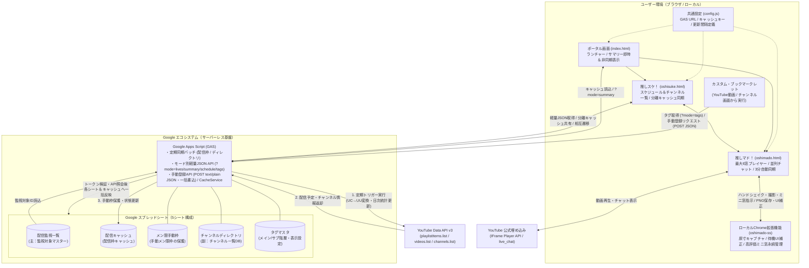

[readme.md](https://github.com/user-attachments/files/35491014/readme.md)
# 推しスケ！ & 推しマド！ (Oshi-Suke! & Oshi-Mado!)

**複数の推し配信者（10〜30チャンネル規模）のライブ配信予定・配信中枠・メンバー限定枠・ゲスト出演枠・チャンネルディレクトリの一元管理（「推しスケ！」）と、複数配信の同時視聴・原寸スクリーンショット撮影（「推しマド！」）を実現する個人開発Webアプリケーション群**

リポジトリ: `youtubelive-schedule-by-ch1munch0`

## 1. 概要・解決する課題

複数のVTuberや配信者を追いかける際、YouTube標準の登録チャンネル一覧や通知だけでは以下の課題が発生します。

* **他チャンネルでの「ゲスト出演（コラボ）枠」の見落とし**（自チャンネルの枠一覧に出ないため把握しづらい）
* **メンバー限定配信やゲリラ枠の埋没**（10〜30チャンネル規模になるとタイムラインが流れやすい）
* **直前リマインドの不足と整理のしづらさ**（開始時間をうっかり過ぎてしまう、グループ・箱・属性ごとに整理して見たい）
* **複数配信の同時視聴・音声切替・高画質キャプチャ・表示崩れの煩雑さ**（コラボ配信や同時刻の推し配信を並べて見たいが、タブを並べると音声切替やチャット確認が大変で、埋め込みプレイヤー特有の待機画面レイアウト崩れや高評価操作、原寸画質でのキャプチャ保存に対応しづらい）

本プロジェクトは、**自動収集（定期バッチ）と手動補完（ブックマークレット）のハイブリッド運用**によってあらゆる配信枠とチャンネル情報を集約する「推しスケ！」と、そこからシームレスに連携して最大6窓の同時視聴・チャット並列表示・原寸スクリーンショット保存を行える複窓プレイヤー「推しマド！」を組み合わせ、維持費ゼロ・高速レスポンスで快適な推し活をサポートします。

## 2. システム構成（アーキテクチャ）

サーバー維持費ゼロかつ高速な画面表示を実現するため、静的ホスティング（GitHub Pages）とGoogleエコシステム（GAS / スプレッドシート / CacheService）を組み合わせたサーバーレス構成を採用しています。共通設定ファイル（`config.js`）でAPIエンドポイントやキャッシュキー・更新周期を一元管理し、ルートページ（`index.html`）をポータル画面として `oshisuke.html` と `oshimado.html` へ明確に分離しています。また、複窓プレイヤーのスクリーンショット機能、埋め込みプレイヤー内の待機画面UI補正、および高評価用ミニウィンドウの制御は、最小権限で設計されたローカルChrome拡張機能（Manifest V3）と `window.postMessage`・拡張機能API・CSSインジェクションで連携します。

### 技術スタックとシート構成

| レイヤー / 対象 | 採用技術・ファイル・シート名 | 役割 |
| :--- | :--- | :--- |
| **共通設定ファイル** | `config.js` (GitHub Pages) | GAS WebアプリURL・`localStorage` キャッシュキー・自動更新周期・`New` バッジ閾値の一元管理 |
| **ポータル（入口）画面** | `index.html` (GitHub Pages) | 「推しスケ！」「推しマド！」へのランチャー画面、キャッシュ即時表示＆`?mode=summary` ステータス表示 |
| **スケジュール画面** | `oshisuke.html` (GitHub Pages / Vanilla JS) | スケジュール＆チャンネル一覧の描画、2階層タグ絞り込み、分離キャッシュ相互同期・遅延ロード |
| **複窓プレイヤー画面** | `oshimado.html` (YouTube IFrame Player API) | 最大6窓同時再生、非表示枠の再生停止・音声退避、並列／タブ切替チャット、3分自動同期・URL状態完全復元 |
| **スクショ・UI・ミニ窓制御拡張機能** | ローカルChrome拡張機能 (`manifest.json` / `background.js` / `content.js`) | `youtube.com/embed/*` 内の `<video>` 原寸PNG保存、待機画面UI補正、`chrome.storage.session` を用いた高評価ミニウィンドウの永続再利用・チャット非表示・自動再生停止 |
| **バックエンド / API** | Google Apps Script (GAS) | YouTube Data APIからの定期データ取得、用途別軽量JSON API（`?mode=lives` / `summary` / `schedule` / `tags`）提供、`doPost` による手動登録リクエスト受信 |
| **インメモリキャッシュ** | GAS `CacheService` | スプレッドシート読み出し負荷を軽減し、JSON応答を高速化（最大6時間保持・配信枠キャッシュとチャンネル配列チャンクの分離保存に対応） |
| **DB（シート1・主）** | `配信監視一覧` | 常時監視対象とする厳選チャンネルID・タグ・フィルター表示名のマスター管理 |
| **DB（シート2・主）** | `配信キャッシュ` | 定期バッチおよび手動登録で収集した配信中・配信予定枠のキャッシュデータ |
| **DB（シート3・主）** | `メン限手動枠` | ブックマークレットから登録されたメンバー限定枠を定期上書きから保護・管理 |
| **DB（シート4・副）** | `チャンネルディレクトリ` | チャンネル一覧ビュー用のストックDB（チャンネル名・アイコン・登録者数・最新動画投稿日・タグ） |
| **DB（シート5・共通）** | `タグマスタ` | タグの区分（メイン / サブ）および表示設定（常時 / 折りたたみ / 自動）の管理 |
| **外部API** | YouTube Data API v3 / IFrame Player API | 配信予定・統計情報の取得、および公式埋め込みプレイヤー・ライブチャットの表示 |
| **データ取り込み補助** | カスタム・ブックマークレット | ブラウザで開いているYouTubeの配信ページやチャンネルページからタグ取得（`?mode=tags`）およびGASへのPOST登録を実行 |

## 3. 要件定義と設計思想

1. **「主（常時監視）」と「副（チャンネルデータベース）」の役割分離**
   * **主（配信スケジュール）**：厳選した限定チャンネルの配信をいち早く、漏れなく追うためのリアルタイム監視基盤。
   * **副（チャンネル一覧）**：気になった配信者や周辺チャンネルをストックし、趣向を整理するためのデータベース。
   * 両者のシートおよびタグ運用をあえて独立させることで、気軽にチャンネルをストックしてもスケジュール画面にノイズが混入せず、監視バッチの実行時間やAPIクォータを保護できる設計としています。
2. **YouTube Data API クォータ制限の回避と3層キャッシュ・軽量APIによる高速描画**
   YouTube Data API v3の日次クォータ上限（10,000ユニット/日）に抵触せず高頻度で定期同期できること。また、閲覧・複窓視聴時はYouTube Data APIへ直接問い合わせず、**ブラウザ `localStorage`（`LIVES` / `FULL` 分離キャッシュ相互同期、およびYouTube上の `BM_TAGS` タグキャッシュ） → GAS `CacheService`（配信枠・チャンネル分割キャッシュ分離） → スプレッドシート** の3層キャッシュにより待たせずに初期描画を行います。さらに呼び出し元に応じた `?mode=lives` / `summary` / `schedule` / `tags` パラメータにより不要なペイロード転送を削減しています（動画再生・チャット表示は公式埋め込み機能を使用するためAPIクォータを一切消費しません）。
3. **自動取得と手動補完のハイブリッド運用**
   定期バッチによる自動収集を基本としつつ、監視外チャンネルへのゲスト出演枠やメンバー限定枠、新規チャンネルのディレクトリ追加をブラウザから数秒で完結できる導線を備えています。
4. **データ保護・運用ヘルスチェックと最小権限セキュリティ**
   `LockService` による排他制御、API一時エラー時の欠落猶予（`missCount` によるリトライ保護）、手動枠の保護、バックエンド異常の自動警告表示に加え、Chrome拡張機能のホスト権限最小化・Service Worker状態永続化・`postMessage` の送信元フレーム検証・`POST` (`text/plain` JSON) によるトークンURL非露出化・インラインエラーハンドラ廃止（CSP親和性確保）により安全かつ堅牢な運用を実現しています。
5. **視聴体験とキャプチャ品質を両立する複窓＆拡張機能連携**
   複窓レイアウト変更時も動画の再生状態を途切れさせないDOM非破棄設計と、縮小レイアウト時の非表示枠自動停止・音声退避ロジックを採用。さらに、別オリジン `iframe` やクロスオリジンウィンドウの制約をローカルChrome拡張機能との連携によって解決し、UIや枠線の映り込みがない配信元ネイティブ解像度でのスクリーンショット保存、待機画面UIの自動補正、および高評価用ミニウィンドウのスマートな再利用制御を実現しています。

## 4. 主要機能・技術的工夫

### クォータ最適化データ取得（`UC` → `UU` 変換方式）

消費コストの高い `search.list`（100ユニット/回）を使用せず、監視対象チャンネルIDの先頭 `UC` を `UU` に置換してアップロード動画プレイリストIDを生成し、`playlistItems.list`（1ユニット/回）で最新枠を取得します。クォータ消費を **100分の1** に圧縮することで、10〜30チャンネル規模でも余裕を持った定期同期を実現しています。

### `CacheService` 分割保存・用途別軽量API・手動登録の高速化

* **100KB制限対策のチャンク分割保存**：`CacheService`（`ScriptCache`）の **1キーあたり100KB（102,400 bytes）制限** をチャンネル数増加（200件超規模）によって超過する課題に対応するため、メモリキャッシュを本体メタ・配信側（`LIVE_SCHEDULE_JSON_V8`）とチャンネル配列側（チャンク分割キー）に分けて保存・復元します。保存失敗やチャンク欠損・破損を検知した場合は関連キーをすべて削除して安全にスプレッドシートから再構築し、実行ログには配信側・チャンネル側・各チャンク・合計のバイト数を出力します。
* **用途別軽量JSON API（`?mode=...`）**：`doGet` リクエスト時に用途に応じた取得モードを指定でき、通信量とGAS側の処理時間を大幅に削減しています。
  * `?mode=lives`（複窓プレイヤー向け）：配信枠とタグメタ・ヘルス情報のみを返却し、チャンネルチャンクの結合処理をスキップして高速応答。
  * `?mode=summary`（ポータル画面向け）：配信中件数・配信予定件数・チャンネル総数・最終更新日時・稼働ステータスのみの軽量サマリーを返却。
  * `?mode=schedule`（スケジュール画面初期表示向け）：配信枠・タグメタ・チャンネル総数（`channelCount`）のみを返却し、チャンネル一覧タブ切替時にフルデータを遅延取得。
  * `?mode=tags`（ブックマークレット・チャンネル登録向け）：タグ一覧（`tagOrder` / `tagMeta`）および照合用の軽量チャンネル情報（`channelId`, `channelUrl`, `tags`）のみを返却。
* **手動登録APIのPOST化・一括書き込み最適化**：手動登録リクエストにおいて、`POST` メソッド＋ `Content-Type: text/plain` のJSONボディ（`e.postData.contents`）でトークンおよび登録データを送信することで、CORSプリフライトを発生させずにブラウザ履歴やリファラへのトークン露出リスクを低減。さらにシートへの追記・更新時は一括書き込みと `LockService` 制御により応答速度と排他安全性を高めています。
* **誤実行防止の関数名整理**：GASエディタ上の誤操作による直接実行を防ぐため、内部処理用・初期移行用の関数名末尾にアンダースコア（`_`）を付与して実行候補プルダウンから整理しています。

### 共通設定（`config.js`）の一元管理＆分離キャッシュ相互同期・3分自動更新

* **設定の一元管理とフォールバック安全設計**：`index.html`・`oshisuke.html`・`oshimado.html` の3画面すべてが共通の `config.js`（`window.OSHISUKE_CONFIG`）を参照し、GAS WebアプリURL・`localStorage` キャッシュキー・自動更新周期・`New` バッジ判定閾値を統一。万が一 `config.js` の読み込みに失敗した場合でも各画面内のフォールバック値で安全に動作します。
* **`localStorage` キャッシュの役割分離＆非破壊マージ同期**：
  * 配信枠・スケジュール共有用の軽量キャッシュ（`oshisuke_lives_cache_v8`）と、チャンネル一覧情報を含むフルキャッシュ（`oshisuke_full_cache_v8`）にキーを分離し、旧バージョンのキャッシュキーからのフォールバック移行にも対応（ブックマークレット側ではYouTubeオリジン上にタグ専用キャッシュ `oshisuke_bm_tags_cache_v2` を保持）。
  * どの画面で軽量API（`?mode=lives` / `?mode=schedule`）を実行しても、既存のチャンネルディレクトリ配列を破壊せずに配信枠データのみをマージ更新するため、画面遷移やタブ切替時も常に最新キャッシュが維持されます。
* **3分周期のバックグラウンド自動更新**：自動リフレッシュ間隔を **3分（`AUTO_REFRESH_INTERVAL_MS`）** に統一し、「推しスケ！」だけでなく「推しマド！」側にもバックグラウンド自動同期・タブ復帰時リフレッシュ・`New` バッジ表示を導入しています。

### ポータル画面（`index.html`）のリアルタイムサマリー表示

* 「推しスケ！」と「推しマド！」への2カラムランチャーに加え、上部ステータスストリップに**現在配信中（LIVE）件数・配信予定件数・登録チャンネル総数・最終更新日時・API取得エラー警告**を表示。
* ローカルの `FULL` / `LIVES` キャッシュ（より新しい方）から0秒で初期表示を行ったあと、裏側で軽量サマリーAPI（`?mode=summary`）を非同期取得して最新状態へ自動更新します。

### 2つのビュー切り替え（配信スケジュール / チャンネル一覧）

* **配信スケジュールビュー**（`oshisuke.html`）：
  * **開始時間順**：最上部に「現在配信中（LIVE）」を固定表示し、以降の配信予定を日付ごと（「今日」「明日」バッジ付き）にグルーピング。
  * **チャンネル別**：`配信監視一覧` シートの登録順（`sortOrder`）に基づき、チャンネル単位で配信枠を整理して表示。
* **チャンネル一覧ビュー（チャンネルディレクトリ）**（`oshisuke.html#channels`）：
  * **タグ別**：メインタグごとにセクション分けし、各枠内は `チャンネルディレクトリ` シートの登録順で整列。現在配信中のチャンネルには `LIVE` ハイライトを付与。
  * **登録者数順 / 動画更新日順**：登録者数や最新動画の投稿日順でのソート、およびチャンネル名・タグによるインクリメンタル検索に対応。
  * **遅延ロード最適化**：初期起動時は軽量モード（`?mode=schedule`）でスケジュールを高速描画し、「チャンネル一覧」タブへ切り替えたタイミングでフルデータ（チャンネルディレクトリ含む）をバックグラウンド取得します。

### 常時追従ツールバー＆プルダウン型2階層タグフィルタリング

* **画面上部追従ツールバー（Sticky UI）**：ヘッダーおよび件数表示・絞り込みボタン・ソート切り替えを含むツールバーを画面上部に常時固定し、ページのどのスクロール位置からでも即座に操作可能。
* **全デバイス共通のプルダウン展開**：PC・モバイルともに絞り込みパネルを常時折りたたみ状態とし、件数表示横のプルダウンボタンからフローティング展開する省スペース設計を採用（コンテンツのレイアウトシフト防止、`Esc` キー・外側クリックでの閉じ操作に対応）。
* **2階層タグ管理（メイン / サブ）**：選択中のメインタグに紐づく配信・チャンネルに存在するサブタグのみを動的に抽出し、使用頻度の低いタグは自動折りたたみ（「さらに表示」）によってUIの肥大化を防止します。

### 視聴UX・リマインド・ヘルスチェック・堅牢性機能

* **ステータス＆直前強調表示**：配信中（LIVE）・配信予定・メンバー限定（開始予定時刻経過時のステータス変化含む）・まもなく配信開始（30分前アンバー枠強調）・新規検知枠（`New` バッジ）を視覚的に区別。
* **連続リロード防止＆通信保護**：「再読込」ボタンに連続押下防止のクールダウン制御（5秒カウントダウン）と通信中ロックを実装し、意図しないAPI連打を防止。
* **異常検知ステータスバッジ**：通信失敗、GAS側のAPI取得エラー、データの鮮度低下（30分以上未更新）、定期トリガー停止の疑い（45分以上実行なし）を自動判定し、ヘッダーに警告バッジを表示します。
* **CSP親和性の高いエラーハンドリング＆デバイス適応ナビゲーション**：HTML内のインライン `onerror` 属性を廃止し、イベント委譲による画像読み込みエラーの集中ハンドリングへ移行。また、PCの横長画面では「推しスケ！」ヘッダーに複窓プレイヤー「推しマド！」への遷移ボタン（`⊞ 推しマド！`）を表示し、画面幅の狭いスマートフォンや縦長比率では自動的に非表示にしてスッキリしたUIを維持します。

### 複窓プレイヤー「推しマド！」（`oshimado.html`）＆拡張機能連携

* **5種類の画面レイアウト＆非表示枠のスマート制御**：`1×2`、`2窓+並列チャット`、`2×2`、`1メイン+3サブ`、`3×2`（最大6窓）を切り替え可能。スロットのDOMを破棄せずCSS Gridで配置変更するため、再生の読み込みが途切れません。また、「2窓+並列チャット」レイアウトでは下段チャットペインに最低高さ（`minmax(min(425px, 54%), 1.1fr)`）を確保し、通常ブラウザ＋ブックマークバー表示時でもチャット入力欄が見切れない視認性を実現しています。さらに、収容枠数の少ないレイアウトへ切り替えた際に非表示となる枠は、**元のミュート状態を退避したうえで自動的に一時停止（`pauseVideo`）＆ミュート**し、ソロ音声枠が非表示になった場合は表示中の枠（メイン枠優先）へソロ音声を自動移譲します。再表示レイアウトへ戻すと元の再生・ミュート状態が自動復帰します。
* **柔軟なチャット表示＆裏通信の停止**：`2窓+チャット` レイアウト時は2枠のライブチャットを画面下部に並列表示し、その他のレイアウトでは右サイドバーのタブで各枠のチャットを瞬時に切り替え可能です（`embed_domain` を自動付与）。チャット欄が非表示となるレイアウトやサイドバー閉鎖時はチャット `iframe` を破棄し、裏側の通信・メモリ消費を抑制します。
* **ワンタッチ音声制御＆キーボードショートカット**：
  * `1`〜`6` キーまたは各枠の「🔊 ソロ」ボタン：指定枠のみ音声ON＋赤枠ハイライト表示（他枠は自動ミュート）
  * `M`：全枠一括ミュート / `U`：表示中の全枠のミュートを一括解除
  * `C`：チャットサイドバー開閉 / `D`：配信枠選択ドロワー開閉 / `F`：ヘッダーを隠す没入モード切替
  * 共有URL（`?v=...`）からの復元時は、複数窓の同時発音を防ぐため初期状態で全枠ミュートとして開始します。
* **「推しスケ！」連携ドロワー＆URL状態完全同期**：ドロワーから配信中・予定枠をワンクリックで任意の枠へセットできるほか、「配信中を一括展開」やYouTube URL／動画IDの複数貼り付け追加（プレイヤー再生開始時の `getVideoData()` からのチャンネル名・タイトル自動補完対応）に対応。現在のセット枠（途中の空き枠 `-` も保持）・レイアウト・メイン枠番号はURLパラメータ（`?v=ID1,-,ID2&layout=2chat&main=2`）へ自動同期され、そのままブックマークや共有が可能です。`?mode=lives` とタイムアウト制御（15秒）、および分離キャッシュへの非破壊マージにより既存のチャンネルキャッシュを壊さずに同期します。
* **拡張機能との起動ハンドシェイク＆送信元フレーム厳密検証**：起動時に `OSHIMADO_EXT_PING` / `OSHIMADO_EXT_READY` でローカル拡張機能の稼働を確認し、未導入環境では待機タイムアウトなしで即座にブラウザ標準のポップアップへフォールバックします。また、スクリーンショット完了通知（`OSHIMADO_CAPTURE_RESULT`）の受信時はオリジンに加えて対象スロットの埋め込みプレイヤー `iframe.contentWindow === event.source` を厳密に検証します。
* **原寸解像度スクリーンショット（Chrome拡張機能連携）**：各枠の「📷」ボタンを押すと `window.postMessage` 経由で埋め込みフレーム内の拡張機能スクリプトへ指示を送信し、HTML5 `<video>` の現在フレームを配信元のネイティブ解像度（`1920×1080` 等）・UIや枠線の映り込みなしのPNG（`推しマド_#1_チャンネル名_日時.png`）として即時ダウンロード保存します（DRM保護動画や未ロード時の例外ハンドリングにも対応）。
* **ワンクリック高評価ミニウィンドウ起動＆永続再利用（Chrome拡張機能連携）**：YouTube公式埋め込みプレイヤーには高評価ボタンが搭載されていないため、各枠の上部バーに「👍」ボタンを配置。クリックすると、アプリ化ウィンドウからのタブ戻りを防ぐ独立したミニウィンドウ（`640×780`・画面右下配置）でYouTube本家視聴ページ（`youtube.com/watch?v=...#oshimado_popup`）を開きます。さらにChrome拡張機能（`background.js` / `content.js`）と連携し、以下の制御をミニウィンドウ限定で自動実行します（通常のYouTubeタブ視聴には一切干渉しません）。
  * **Service Worker スリープ耐性のある同一ウィンドウ再利用**：`chrome.storage.session` にミニウィンドウID・タブIDを永続化しているため、Service Workerが再起動した後でも新しい窓を増やさず同じ小窓のURLを切り替えて最前面へフォーカスし、連続でテンポよく高評価を押せます。
  * **ライブチャットの自動折りたたみ**：小窓内のライブチャット欄を自動で閉じ、裏側の通信・メモリ消費を抑えます。
  * **初期自動再生のブロック**：複窓側との音声被りを防ぐため、開いた直後の自動再生を自動で一時停止します（小窓内のプレイヤーをクリックするか `Space` / `K` キーを押すと通常通り手動再生できます）。
* **埋め込みプレイヤー待機画面のUI・サムネイル自動補正（Chrome拡張機能連携）**：YouTube公式埋め込みプレイヤーの配信開始前待機画面において、拡大トリミングされる背景サムネイル（`.ytp-offline-slate` 等）を `background-size: contain` で16:9の全体表示（見切れ防止）へ統一。さらに、日本語フォントや狭幅サブ枠で崩れやすい「通知を受け取る」ボタン（`.ytp-offline-slate-bar`）を横並びのフレキシブル配置および狭幅向けコンパクト表示（`max-width: 520px`）へ自動調整し、どのレイアウトでも枠内に美しく収めます。

### ブックマークレットによるワンクリック登録＆データ保護

* YouTubeの**動画・配信ページ**で実行すると、動画ID・配信情報を抽出して「一般枠（ゲスト出演など）」または「メン限枠」を選択しGAS（`doPost` / `text/plain` JSON）へPOST登録（終了検知時は自動でキャッシュから除外）。
* YouTubeの**チャンネルページ**で実行すると、`?mode=tags`（およびYouTube側 `localStorage` の `BM_TAGS` キャッシュ）から取得した既存タグチップの選択・新規タグ入力を行い `チャンネルディレクトリ` へPOST追加・更新可能（GET経由の登録リクエストはセキュリティ上拒否）。

## 5. セットアップ・運用手順

### 1. Google スプレッドシートの準備

新規スプレッドシートを作成し、以下の2つのシートを作成します（残りの `メン限手動枠`・`チャンネルディレクトリ`・`タグマスタ` は初回実行時に自動生成されます）。

* **`配信監視一覧`**：1行目をヘッダーとし、2行目以降に `A列: チャンネルID (UC...)`、`B列: タグ（カンマ区切り）`、`C列: フィルター表示名（任意）` を記載します。
* **`配信キャッシュ`**：空のシートを作成しておきます（ヘッダー・データは初回同期時に自動書き込みされます）。

### 2. Google Apps Script (GAS) の初期設定

1. スプレッドシートの「拡張機能」＞「Apps Script」を開き、バックエンドコードを貼り付けて保存します。
2. エディタ左メニューの「サービス（＋）」から **`YouTube Data API v3`** を追加して有効化します。
3. 関数選択プルダウンから `setupAdminToken` を実行し、実行ログに出力される手動登録用の秘密トークンを控えます（トークンを再発行したい場合は `rotateAdminToken` を実行します）。
4. 必要に応じて `initTagMasterSheet` を実行し、既存タグから `タグマスタ` シートを初期生成します。

### 3. Webアプリのデプロイとフロントエンド設定

1. GASエディタ右上の「デプロイ」＞「新しいデプロイ」から種類に **「ウェブアプリ」** を選択します。
   * **次のユーザーとして実行**：自分
   * **アクセスできるユーザー**：全員（GitHub Pages および YouTube画面上のブックマークレットからリクエストを受け付けるため）
2. 発行されたウェブアプリURL（`.../exec`）を、共通設定ファイル **`config.js`** の `GAS_URL` に設定し、`config.js`・`index.html`・`oshisuke.html`・`oshimado.html` の4ファイルをGitHub Pagesの同一ディレクトリへ配置します。
3. ブックマークレット内の `GAS_URL` および `TOKEN`（手順2で取得した秘密トークン）を設定し、ブラウザのブックマークへ登録します。
   * **※設定同期の注意**：ブックマークレットは設計上外部ファイル（`config.js`）を読み込めないため、`GAS_URL` やキャッシュキー（`BM_TAGS`）を変更した際は `config.js` とブックマークレットの値を手動で揃えてください。また、`index.html`・`oshisuke.html`・`oshimado.html` には `config.js` 読込失敗時のフォールバック値が含まれているため、`GAS_URL` 等を変更した場合は各HTML内のフォールバック値も合わせて更新してください。

### 4. 定期実行トリガーの設定

GASエディタ左メニューの「トリガー（時計アイコン）」から以下の2つを設定します。

* **`updateLiveCache`**：時間主導型 / 分ベースのタイマー / **15分おき**（配信予定・ライブ状態の定期同期）
* **`updateChannelDirectory`**：時間主導型 / 日付ベースのタイマー / **1日1回**（チャンネルディレクトリの登録者数・アイコン・最新投稿日の更新）

### 5. スクリーンショット・UI補正・ミニウィンドウ制御用ローカルChrome拡張機能の導入（任意・無料）

複窓プレイヤー「推しマド！」の各窓にある「📷」ボタンからの原寸スクリーンショット撮影、埋め込みプレイヤーの待機画面UI補正、および「👍」ボタンによるミニウィンドウの再利用・チャット非表示・自動再生停止を有効にしたい場合のみ、以下の手順でローカル拡張機能を読み込みます（ストア公開ではないため開発者登録費用はかかりません）。

1. ローカルディスク上に専用フォルダを作成します（例：`C:\利用ソフト\oshimado-ss` ※PC起動時の読み込みエラーを防ぐため、仮想ドライブではなくローカルストレージ上を推奨）。
2. フォルダ内に以下の3ファイルをUTF-8で保存します。
   * **`manifest.json`**：最小限の権限（`storage`）と対象ホスト限定（`youtube.com` / `youtube-nocookie.com` / 本番GitHub Pages URL）を設定したマニフェストファイル
   * **`background.js`**：`chrome.windows` / `chrome.tabs` / `chrome.storage.session` APIを用いて高評価用ミニウィンドウの生成・Service Worker再起動を跨いだ既存ウィンドウのURL更新・フォーカス制御を行う Service Worker
   * **`content.js`**：起動ハンドシェイク応答、待機UI補正スタイルの注入、`<video>` の `<canvas>` 経由原寸PNG保存、および `#oshimado_popup` ウィンドウ限定のチャット折りたたみ・初期自動再生停止を行うスクリプト
3. Chromeで `chrome://extensions` を開き、右上の **「デベロッパー モード」** をオンにします。
4. 左上の **「パッケージ化されていない拡張機能を読み込む」** から作成したフォルダを選択すれば導入完了です。

## 6. 開発ロードマップ

* **Phase 1：MVP構築・API＆キャッシュ基盤の確立**
  * Google スプレッドシートのシート設計およびGASによる `UC`→`UU` 変換を用いたYouTube Data API連携ロジックを構築。
* **Phase 2：例外枠対応・手動登録ワークフローの導入**
  * 監視チャンネル外での「ゲスト出演枠」や「メン限枠」、さらには新規チャンネル追加をカバーする専用ブックマークレットを開発・統合。
* **Phase 3：UX向上・2階層タグ＆チャンネル一覧ビューの実装**
  * 「配信スケジュール」と「チャンネル一覧」の2ビュー構成へ拡張し、メイン／サブの2階層タグフィルタリング・インクリメンタル検索を導入。
* **Phase 4：安定運用・ヘルスチェック＆UI/データ設計の洗練**
  * `localStorage` キャッシュによる即時初期描画、バックグラウンド自動更新、APIエラー・定期トリガー停止検知バッジを実装。
  * 主機能用マスターシートを `配信監視一覧` へリネームして副機能（`チャンネルディレクトリ`）との名称衝突を解消し、5シート構成のアーキテクチャと運用ドキュメントを整備。
  * ヘッダー＋ツールバーの画面上部追従固定（Sticky）と、全デバイス共通のプルダウン型絞り込みUIへ刷新。
  * `CacheService` の100KB制限対策としてチャンネル配列のチャンク分割保存（`CONFIG.CHANNEL_CACHE_CHUNK_SIZE`）、チャンク別バイト数ログ出力、および内部関数の接尾辞 `_` 整理を実装。
* **Phase 5：複窓プレイヤー「推しマド！」＆拡張機能連携・ポータル構成の実装**
  * ルートをポータル画面（`index.html`）とし、「推しスケ！」（`oshisuke.html`）と「推しマド！」（`oshimado.html`）を独立URLで運用できる構成へ整理。
  * 最大6窓のDOM非破棄レイアウト切替、ソロ音声制御、並列／タブチャット、「推しスケ！」連携ドロワーを備えた `oshimado.html` を構築。
  * ローカルChrome拡張機能との `postMessage` 連携による原寸解像度スクリーンショット機能、高評価ミニウィンドウ起動（「👍」ボタン）、および埋め込み待機画面のサムネイル・通知ボタンUI自動補正を実装。
* **Phase 6：軽量API化・セキュリティ強化・複窓制御＆共通基盤の仕上げ（現在）**
  * **Chrome拡張機能＆GASの堅牢化（ステップ1）**：拡張機能のホスト権限最小化、`chrome.storage.session` によるミニウィンドウIDのService Workerスリープ耐性確保、GASの用途別軽量API（`?mode=lives` / `summary` / `schedule` / `tags`）、および手動登録APIの `POST` (`text/plain` JSON) 対応・一括書き込み最適化を実装。
  * **複窓プレイヤーの制御改善（ステップ2）**：レイアウト縮小時に非表示となる枠の自動停止・ミュート退避とソロ音声の自動移譲、チャット非表示時の裏通信停止、「🔊 全ミュート解除（`U`）」ボタン追加、拡張機能ハンドシェイクと `iframe.contentWindow` の厳密な送信元検証、ならびに空き枠位置（`-`）とメイン枠番号を含むURL状態完全復元に対応。
  * **共通設定化・キャッシュ分離相互同期・仕上げ（ステップ3）**：`config.js` によるGAS URL・キャッシュキー（`LIVES` / `FULL` / `BM_TAGS`）・更新間隔・`New` バッジ閾値の一元管理とフォールバック設計を全3画面へ適用。分離キャッシュの非破壊マージ同期と3分周期の自動更新（`oshimado.html` 含む）、ポータル画面の `?mode=summary` リアルタイムサマリー表示、「推しスケ！」の再読込クールダウン・遅延ロード・CSP対応エラーハンドリング、および「推しマド！」の2窓チャット高さ確保・動画メタデータ自動補完を実装。
