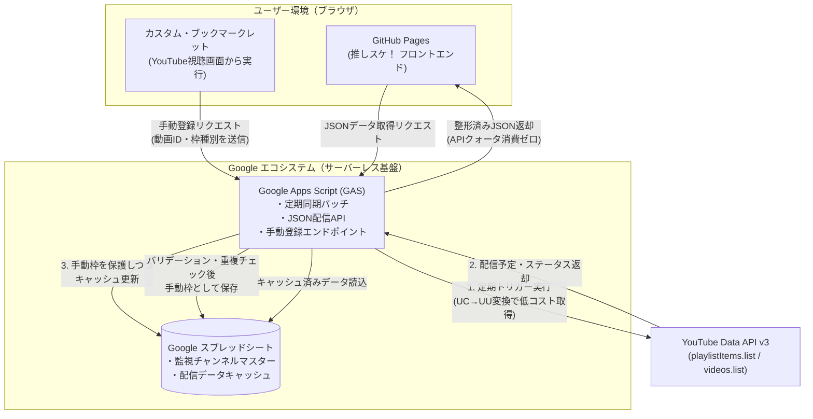

[readme.md](https://github.com/user-attachments/files/35275503/readme.md)
# 推しスケ！ (Oshi-Suke!)

**複数の推し配信者（10〜30チャンネル規模）のライブ配信予定・配信中枠・メンバー限定枠・ゲスト出演枠を一元管理する個人開発Webアプリケーション**

リポジトリ: `youtubelive-schedule-by-ch1munch0`

---

## 1. 概要・解決する課題

複数のVTuberや配信者を追いかける際、YouTube標準の登録チャンネル一覧や通知だけでは以下の課題が発生します。

* **他チャンネルでの「ゲスト出演（コラボ）枠」の見落とし**（自チャンネルの枠一覧に出ないため把握しづらい）
* **メンバー限定配信やゲリラ枠の埋没**（10〜30チャンネル規模になるとタイムラインが流れやすい）
* **直前リマインドの不足**（開始時間をうっかり過ぎてしまう）

「推しスケ！」は、**自動収集（定期バッチ）と手動補完（ブックマークレット）のハイブリッド運用**によって、あらゆる形式の配信枠を単一画面へ集約し、維持費ゼロ・高速レスポンスで快適な推し活をサポートする個人向け基幹システムです。

---

## 2. システム構成（アーキテクチャ）

サーバー維持費ゼロかつ高速な画面表示を実現するため、静的ホスティング（GitHub Pages）とGoogleエコシステム（GAS / スプレッドシート）を組み合わせたサーバーレス構成を採用しています。

### 技術スタック

| レイヤー | 採用技術・サービス | 役割 |
| :--- | :--- | :--- |
| **フロントエンド** | GitHub Pages (HTML / CSS / JavaScript) | スケジュール一覧の表示、ステータス別フィルタリング、通知UIの提供 |
| **バックエンド / API** | Google Apps Script (GAS) | YouTube Data APIからの定期データ取得、JSON APIの提供、手動登録リクエストの受信 |
| **データベース / キャッシュ** | Google スプレッドシート | 監視対象チャンネルのマスター管理、およびAPI取得済みデータ・手動登録枠のキャッシュ基盤 |
| **外部API** | YouTube Data API v3 | チャンネルのアップロード動画・ライブ配信情報（予定日時・ステータス等）の取得 |
| **データ取り込み補助** | カスタム・ブックマークレット | ブラウザで開いているYouTube配信ページからワンクリックでGASへ枠情報を送信 |

---

## 3. 要件定義と設計思想

1. **10〜30チャンネル規模の配信枠を漏れなく集約**
   通常配信枠だけでなく、見落としやすい「メンバー限定枠」や他チャンネルでの「ゲスト出演枠」を単一画面で俯瞰できること。
2. **YouTube Data API クォータ制限の回避と高速表示**
   YouTube Data API v3の日次クォータ上限（10,000ユニット/日）に抵触せず、30チャンネル規模でも余裕を持って定期同期できること。また、フロントエンド閲覧時はAPIへ直接問い合わせず、キャッシュ経由で即座に描画すること。
3. **自動取得と手動補完のハイブリッド運用**
   定期バッチによる自動収集を基本としつつ、監視外チャンネルへのゲスト出演枠などをブラウザから数秒で登録できる運用導線を備えること。
4. **ヒューマンエラーとデータ消失を防ぐ安全性**
   手動登録時の誤入力や重複登録をブロックし、さらに定期バッチの自動更新によって手動登録枠が上書き・消去されないデータ保護機構を備えること。

---

## 4. 主要機能・技術的工夫

### クォータ最適化データ取得（`UC` → `UU` 変換方式）
消費コストの高い `search.list`（100ユニット/回）を使用せず、監視対象チャンネルIDの先頭 `UC` を `UU` に置換してアップロード動画プレイリストIDを生成し、`playlistItems.list`（1ユニット/回）で最新枠を取得します。これによりクォータ消費を **100分の1** に圧縮し、10〜30チャンネル規模でも安定した高頻度同期を実現しています。

### スプレッドシートによるマスター＆キャッシュ基盤
Google スプレッドシートを「監視チャンネル一覧マスター」兼「JSONキャッシュストア」として運用しています。GASの定期トリガーで取得・整形した結果をシートに保持し、GitHub Pages側はキャッシュされたJSONを読み込むことで **閲覧時のAPI消費ゼロ・高速レスポンス** を両立しています。

### ブックマークレットによるワンクリック手動枠登録
YouTubeの配信ページを開いた状態でブックマークレットを実行すると、現在のURLから動画IDを自動抽出し、枠種別（ゲスト出演・メン限など）を付与してGASのWebアプリURLへ送信・登録します。

### 誤登録防止・手動データ保護ロジック
* **バリデーション＆重複ブロック**：不正なURLやパラメータの送信を弾き、既に登録済みの動画IDの重複登録を防止します。
* **排他・保護ロジック**：定期同期バッチ実行時、手動登録フラグが付与されたレコードを保護対象として扱い、自動取得データによる上書きや消去を防ぎます。

### 視聴UX・リマインド機能
* **ステータス分類表示**：配信中（LIVE）・配信予定・メンバー限定・ゲスト出演などをバッジや配色で視覚的に区別。
* **新規追加ハイライト**：新たに検知・追加された配信枠を強調表示し、ゲリラ枠や予定追加を即座に判別可能。
* **30分前通知機能**：配信開始30分前のタイミングで通知を行い、視聴漏れを防止。

---

## 5. 開発ロードマップ

* **Phase 1：MVP構築・API＆キャッシュ基盤の確立**
  * Google スプレッドシートのシート設計（チャンネルマスター・データキャッシュ）を実施。
  * GASによる `UC`→`UU` 変換を用いたYouTube Data API連携ロジックを構築し、GitHub PagesからJSONを取得して一覧表示する基本機能をリリース。
* **Phase 2：例外枠対応・手動登録ワークフローの導入**
  * 監視チャンネル外での「ゲスト出演枠」や特殊な「メン限枠」をカバーするため、ワンクリックでGASへ登録リクエストを送る専用ブックマークレットを開発・統合。
* **Phase 3：UX向上＆データ保護の精緻化**
  * 日常運用での見落としを防ぐ「新規追加表示」および「30分前通知機能」を実装。
  * 運用中の誤操作や同期競合によるデータ破損を防ぐため、誤登録防止バリデーションと手動データの保護仕様を強化。
* **Phase 4：ドキュメント整備・今後の拡張（現在〜ネクストステップ）**
  * アーキテクチャおよび仕様のドキュメント化。
  * チャンネル数増加に応じたバッチ処理のさらなる並列・最適化や、UI/UXのブラッシュアップ。
