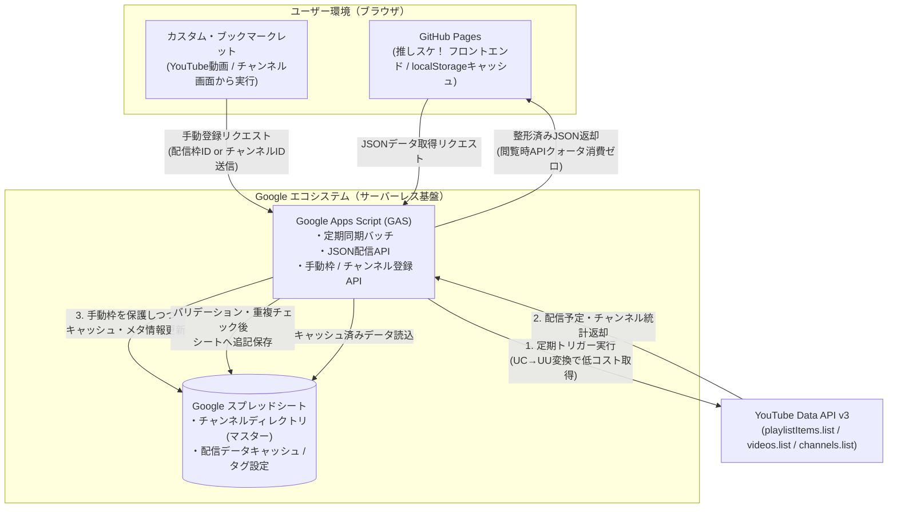

[readme.md](https://github.com/user-attachments/files/35324450/readme.md)
# 推しスケ！ (Oshi-Suke!)

**複数の推し配信者（10〜30チャンネル規模）のライブ配信予定・配信中枠・メンバー限定枠・ゲスト出演枠、および推しチャンネルディレクトリを一元管理する個人開発Webアプリケーション**

リポジトリ: `youtubelive-schedule-by-ch1munch0`

---

## 1. 概要・解決する課題

複数のVTuberや配信者を追いかける際、YouTube標準の登録チャンネル一覧や通知だけでは以下の課題が発生します。

* **他チャンネルでの「ゲスト出演（コラボ）枠」の見落とし**（自チャンネルの枠一覧に出ないため把握しづらい）
* **メンバー限定配信やゲリラ枠の埋没**（10〜30チャンネル規模になるとタイムラインが流れやすい）
* **直前リマインドの不足と整理のしづらさ**（開始時間をうっかり過ぎてしまう、グループ・箱・属性ごとに整理して見たい）

「推しスケ！」は、**自動収集（定期バッチ）と手動補完（ブックマークレット）のハイブリッド運用**によって、あらゆる形式の配信枠とチャンネル情報を単一画面へ集約し、維持費ゼロ・高速レスポンスで快適な推し活をサポートする個人向けWebアプリケーションです。

---

## 2. システム構成（アーキテクチャ）

サーバー維持費ゼロかつ高速な画面表示を実現するため、静的ホスティング（GitHub Pages）とGoogleエコシステム（GAS / スプレッドシート）を組み合わせたサーバーレス構成を採用しています。

### 技術スタック

| レイヤー | 採用技術・サービス | 役割 |
| :--- | :--- | :--- |
| **フロントエンド** | GitHub Pages (HTML / CSS / Vanilla JS) | スケジュール＆チャンネル一覧の描画、2階層タグ絞り込み、ローカルキャッシュ即時表示 |
| **バックエンド / API** | Google Apps Script (GAS) | YouTube Data APIからの定期データ取得、JSON APIの提供、手動登録リクエストの受信 |
| **データベース / キャッシュ** | Google スプレッドシート | 監視チャンネルのマスター管理（`チャンネルディレクトリ`）、タグ設定、配信キャッシュ基盤 |
| **外部API** | YouTube Data API v3 | チャンネルのアップロード動画・ライブ配信予定・登録者数・アイコン情報の取得 |
| **データ取り込み補助** | カスタム・ブックマークレット | ブラウザで開いているYouTubeの配信ページやチャンネルページからワンクリックでGASへ登録 |

---

## 3. 要件定義と設計思想

1. **10〜30チャンネル規模の配信枠とチャンネル情報を漏れなく集約**
   通常配信枠だけでなく、見落としやすい「メンバー限定枠」や他チャンネルでの「ゲスト出演枠」を単一画面で俯瞰でき、さらに登録チャンネル自体のディレクトリ（登録者数・最新投稿日・配信中状態）も管理できること。
2. **YouTube Data API クォータ制限の回避と即時描画**
   YouTube Data API v3の日次クォータ上限（10,000ユニット/日）に抵触せず高頻度で定期同期できること。また、フロントエンド閲覧時はAPIへ直接問い合わせず、スプレッドシートキャッシュ＋ブラウザの `localStorage` により待たせずに初期描画すること。
3. **自動取得と手動補完のハイブリッド運用**
   定期バッチによる自動収集を基本としつつ、監視外チャンネルへのゲスト出演枠や新規推しチャンネルの追加をブラウザから数秒で完結できる運用導線を備えること。
4. **データ保護と運用ヘルスチェックの可視化**
   手動登録時の重複ブロックや自動更新による上書き防止に加え、バックエンドのAPIエラーやトリガー停止の疑いをフロントエンド側で自動検知して警告表示できること。

---

## 4. 主要機能・技術的工夫

### クォータ最適化データ取得（`UC` → `UU` 変換方式）
消費コストの高い `search.list`（100ユニット/回）を使用せず、監視対象チャンネルIDの先頭 `UC` を `UU` に置換してアップロード動画プレイリストIDを生成し、`playlistItems.list`（1ユニット/回）で最新枠を取得します。クォータ消費を **100分の1** に圧縮することで、10〜30チャンネル規模でも余裕を持った定期同期を実現しています。

### 2つのビュー切り替え（配信スケジュール / チャンネル一覧）
* **配信スケジュールビュー**：
  * **開始時間順**：最上部に「現在配信中（LIVE）」を固定表示し、以降の配信予定を日付ごと（「今日」「明日」バッジ付き）にグルーピング。
  * **チャンネル別**：スプレッドシートの登録順（`sortOrder`）に基づき、チャンネル単位で配信枠を整理して表示。
* **チャンネル一覧ビュー（チャンネルディレクトリ）**：
  * **タグ別**：メインタグごとにセクション分けし、各枠内はスプレッドシート（`チャンネルディレクトリ`）の登録順で整列。現在配信中のチャンネルには `LIVE` ハイライトを付与。
  * **登録者数順 / 動画更新日順**：登録者数や最新動画の投稿日順でのソート、およびチャンネル名・タグによるインクリメンタル検索に対応。

### 2階層タグフィルタリング（メインタグ / サブタグ）
* タグを「メイン（箱・グループ・主軸カテゴリ等）」と「サブ（配信内容・属性等）」の2階層で管理。
* 選択中のメインタグに紐づく配信・チャンネルに存在するサブタグのみを動的に抽出し、タグ数が多い場合は自動折りたたみ（「さらに表示」）によってUIの肥大化を防止します。

### 視聴UX・リマインド・ヘルスチェック機能
* **ステータス＆直前強調表示**：配信中（LIVE）・配信予定・メンバー限定（開始予定時刻経過時のステータス変化含む）・まもなく配信開始（30分前アンバー枠強調）・新規検知枠（`New` バッジ）を視覚的に区別。
* **キャッシュ即時表示＆自動更新**：`localStorage` に保存した前回キャッシュでページを開いた瞬間に描画を行い、バックグラウンドで最新JSONを同期（以降5分ごとに自動リフレッシュ）。
* **異常検知ステータスバッジ**：通信失敗、GAS側のAPI取得エラー、データの鮮度低下（30分以上未更新）、定期トリガー停止の疑い（45分以上実行なし）を自動判定し、ヘッダーに警告バッジを表示します。
* **セキュリティ配慮**：取得データのHTMLエスケープ処理、許可ドメイン（YouTube公式CDN / ドメインのみ）による画像・リンクURLのサニタイズ、検索エンジン避け（`noindex, nofollow`）を実装。

### ブックマークレットによるワンクリック登録＆データ保護
* YouTubeの**動画・配信ページ**で実行すると、動画IDを抽出してゲスト枠やメン限枠としてGASへ手動登録（自動同期時の上書き・削除から保護）。
* YouTubeの**チャンネルページ**で実行すると、新規監視チャンネルとして `チャンネルディレクトリ` へ直接追加可能。

---

## 5. 開発ロードマップ

* **Phase 1：MVP構築・API＆キャッシュ基盤の確立**
  * Google スプレッドシートのシート設計（チャンネルマスター・データキャッシュ）を実施。
  * GASによる `UC`→`UU` 変換を用いたYouTube Data API連携ロジックを構築し、GitHub PagesからJSONを取得して一覧表示する基本機能をリリース。
* **Phase 2：例外枠対応・手動登録ワークフローの導入**
  * 監視チャンネル外での「ゲスト出演枠」や「メン限枠」、さらには新規チャンネル追加をカバーする専用ブックマークレットを開発・統合。
* **Phase 3：UX向上・2階層タグ＆チャンネル一覧ビューの実装**
  * 「配信スケジュール」と「チャンネル一覧」の2ビュー構成へ拡張し、メイン／サブの2階層タグフィルタリング・インクリメンタル検索を実装。
  * 「新規追加（New）表示」「30分前直前強調」「開始時間順／チャンネル別切り替え」「モバイル用折りたたみフィルタUI」を導入。
* **Phase 4：安定運用・ヘルスチェック＆高速化の精緻化（現在）**
  * `localStorage` キャッシュによる即時初期描画、バックグラウンド自動更新、APIエラー・定期トリガー停止検知バッジを実装。
  * URLサニタイズ・XSS対策などのセキュリティ強化とドキュメントの最新化を完了。
