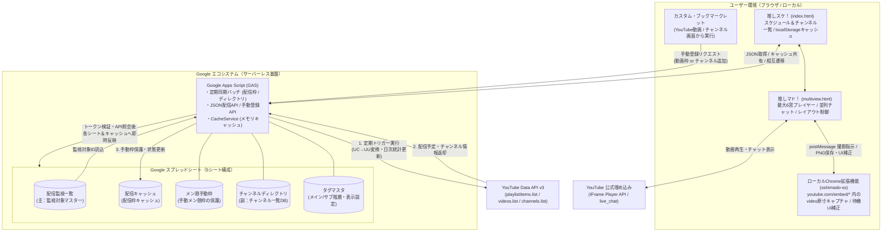

[readme.md](https://github.com/user-attachments/files/35407308/readme.md)
# 推しスケ！ & 推しマド！ (Oshi-Suke! & Oshi-Mado!)

**複数の推し配信者（10〜30チャンネル規模）のライブ配信予定・配信中枠・メンバー限定枠・ゲスト出演枠・チャンネルディレクトリの一元管理（「推しスケ！」）と、複数配信の同時視聴・原寸スクリーンショット撮影（「推しマド！」）を実現する個人開発Webアプリケーション群**

リポジトリ: `youtubelive-schedule-by-ch1munch0`

## 1. 概要・解決する課題

複数のVTuberや配信者を追いかける際、YouTube標準の登録チャンネル一覧や通知だけでは以下の課題が発生します。

* **他チャンネルでの「ゲスト出演（コラボ）枠」の見落とし**（自チャンネルの枠一覧に出ないため把握しづらい）
* **メンバー限定配信やゲリラ枠の埋没**（10〜30チャンネル規模になるとタイムラインが流れやすい）
* **直前リマインドの不足と整理のしづらさ**（開始時間をうっかり過ぎてしまう、グループ・箱・属性ごとに整理して見たい）
* **複数配信の同時視聴・音声切替・高画質キャプチャ・表示崩れの煩雑さ**（コラボ配信や同時刻の推し配信を並べて見たいが、タブを並べると音声切替やチャット確認が大変で、埋め込みプレイヤー特有の待機画面レイアウト崩れや原寸画質でのキャプチャ保存に対応しづらい）

本プロジェクトは、**自動収集（定期バッチ）と手動補完（ブックマークレット）のハイブリッド運用**によってあらゆる配信枠とチャンネル情報を集約する「推しスケ！」と、そこからシームレスに連携して最大6窓の同時視聴・チャット並列表示・原寸スクリーンショット保存を行える複窓プレイヤー「推しマド！」を組み合わせ、維持費ゼロ・高速レスポンスで快適な推し活をサポートします。

## 2. システム構成（アーキテクチャ）

サーバー維持費ゼロかつ高速な画面表示を実現するため、静的ホスティング（GitHub Pages）とGoogleエコシステム（GAS / スプレッドシート / CacheService）を組み合わせたサーバーレス構成を採用しています。また、複窓プレイヤーのスクリーンショット機能および埋め込みプレイヤー内の待機画面UI補正は、自分専用のローカルChrome拡張機能（Manifest V3）と `window.postMessage`・CSSインジェクションで連携します。

### 技術スタックとシート構成

| レイヤー / 対象 | 採用技術・ファイル・シート名 | 役割 |
| :--- | :--- | :--- |
| **スケジュール画面** | `index.html` (GitHub Pages / Vanilla JS) | スケジュール＆チャンネル一覧の描画、2階層タグ絞り込み、`localStorage` 即時表示 |
| **複窓プレイヤー画面** | `multiview.html` (YouTube IFrame Player API) | 最大6窓同時再生、並列／タブ切替チャット、ソロ音声制御、URL状態同期 |
| **スクショ・UI補正拡張機能** | ローカルChrome拡張機能 (`manifest.json` / `content.js`) | `youtube.com/embed/*` 内の `<video>` 原寸PNG保存、および待機サムネイル全体表示・通知ボタン崩れ補正 |
| **バックエンド / API** | Google Apps Script (GAS) | YouTube Data APIからの定期データ取得、JSON API提供、手動登録リクエストの受信 |
| **インメモリキャッシュ** | GAS `CacheService` | スプレッドシート読み出し負荷を軽減し、JSON応答を高速化（最大6時間保持） |
| **DB（シート1・主）** | `配信監視一覧` | 常時監視対象とする厳選チャンネルID・タグ・フィルター表示名のマスター管理 |
| **DB（シート2・主）** | `配信キャッシュ` | 定期バッチおよび手動登録で収集した配信中・配信予定枠のキャッシュデータ |
| **DB（シート3・主）** | `メン限手動枠` | ブックマークレットから登録されたメンバー限定枠を定期上書きから保護・管理 |
| **DB（シート4・副）** | `チャンネルディレクトリ` | チャンネル一覧ビュー用のストックDB（チャンネル名・アイコン・登録者数・最新動画投稿日・タグ） |
| **DB（シート5・共通）** | `タグマスタ` | タグの区分（メイン / サブ）および表示設定（常時 / 折りたたみ / 自動）の管理 |
| **外部API** | YouTube Data API v3 / IFrame Player API | 配信予定・統計情報の取得、および公式埋め込みプレイヤー・ライブチャットの表示 |
| **データ取り込み補助** | カスタム・ブックマークレット | ブラウザで開いているYouTubeの配信ページやチャンネルページからワンクリックでGASへ登録 |

## 3. 要件定義と設計思想

1. **「主（常時監視）」と「副（チャンネルデータベース）」の役割分離**
   * **主（配信スケジュール）**：厳選した限定チャンネルの配信をいち早く、漏れなく追うためのリアルタイム監視基盤。
   * **副（チャンネル一覧）**：気になった配信者や周辺チャンネルをストックし、趣向を整理するためのデータベース。
   * 両者のシートおよびタグ運用をあえて独立させることで、気軽にチャンネルをストックしてもスケジュール画面にノイズが混入せず、監視バッチの実行時間やAPIクォータを保護できる設計としています。
2. **YouTube Data API クォータ制限の回避と3層キャッシュによる即時描画**
   YouTube Data API v3の日次クォータ上限（10,000ユニット/日）に抵触せず高頻度で定期同期できること。また、閲覧・複窓視聴時はYouTube Data APIへ直接問い合わせず、**ブラウザ `localStorage` → GAS `CacheService` → スプレッドシート** の3層キャッシュにより待たせずに初期描画を行います（動画再生・チャット表示は公式埋め込み機能を使用するためAPIクォータを一切消費しません）。
3. **自動取得と手動補完のハイブリッド運用**
   定期バッチによる自動収集を基本としつつ、監視外チャンネルへのゲスト出演枠やメンバー限定枠、新規チャンネルのディレクトリ追加をブラウザから数秒で完結できる導線を備えています。
4. **データ保護と運用ヘルスチェックの可視化**
   `LockService` による排他制御、API一時エラー時の欠落猶予（`missCount` によるリトライ保護）、手動枠の保護に加え、バックエンドのAPIエラーや定期トリガー停止の疑いをフロントエンド側で自動検知して警告表示します。
5. **視聴体験とキャプチャ品質を両立する複窓＆拡張機能連携**
   複窓レイアウト変更時も動画の再生状態を途切れさせないDOM非破棄設計を採用。さらに、別オリジン `iframe` の制約をローカルChrome拡張機能との連携によって解決し、UIや枠線の映り込みがない配信元ネイティブ解像度でのスクリーンショット保存と、複窓時の待機画面UI（サムネイル見切れ・通知ボタンのはみ出し）の自動補正を実現しています。

## 4. 主要機能・技術的工夫

### クォータ最適化データ取得（`UC` → `UU` 変換方式）

消費コストの高い `search.list`（100ユニット/回）を使用せず、監視対象チャンネルIDの先頭 `UC` を `UU` に置換してアップロード動画プレイリストIDを生成し、`playlistItems.list`（1ユニット/回）で最新枠を取得します。クォータ消費を **100分の1** に圧縮することで、10〜30チャンネル規模でも余裕を持った定期同期を実現しています。

### 2つのビュー切り替え（配信スケジュール / チャンネル一覧）

* **配信スケジュールビュー**：
  * **開始時間順**：最上部に「現在配信中（LIVE）」を固定表示し、以降の配信予定を日付ごと（「今日」「明日」バッジ付き）にグルーピング。
  * **チャンネル別**：`配信監視一覧` シートの登録順（`sortOrder`）に基づき、チャンネル単位で配信枠を整理して表示。
* **チャンネル一覧ビュー（チャンネルディレクトリ）**：
  * **タグ別**：メインタグごとにセクション分けし、各枠内は `チャンネルディレクトリ` シートの登録順で整列。現在配信中のチャンネルには `LIVE` ハイライトを付与。
  * **登録者数順 / 動画更新日順**：登録者数や最新動画の投稿日順でのソート、およびチャンネル名・タグによるインクリメンタル検索に対応。

### 常時追従ツールバー＆プルダウン型2階層タグフィルタリング

* **画面上部追従ツールバー（Sticky UI）**：ヘッダーおよび件数表示・絞り込みボタン・ソート切り替えを含むツールバーを画面上部に常時固定し、ページのどのスクロール位置からでも即座に操作可能。
* **全デバイス共通のプルダウン展開**：PC・モバイルともに絞り込みパネルを常時折りたたみ状態とし、件数表示横のプルダウンボタンからフローティング展開する省スペース設計を採用（コンテンツのレイアウトシフト防止、`Esc` キー・外側クリックでの閉じ操作に対応）。
* **2階層タグ管理（メイン / サブ）**：選択中のメインタグに紐づく配信・チャンネルに存在するサブタグのみを動的に抽出し、使用頻度の低いタグは自動折りたたみ（「さらに表示」）によってUIの肥大化を防止します。

### 視聴UX・リマインド・ヘルスチェック機能

* **ステータス＆直前強調表示**：配信中（LIVE）・配信予定・メンバー限定（開始予定時刻経過時のステータス変化含む）・まもなく配信開始（30分前アンバー枠強調）・新規検知枠（`New` バッジ）を視覚的に区別。
* **キャッシュ即時表示＆自動更新**：`localStorage` に保存した前回キャッシュでページを開いた瞬間に描画を行い、バックグラウンドで最新JSONを同期（以降5分ごとに自動リフレッシュ）。
* **異常検知ステータスバッジ**：通信失敗、GAS側のAPI取得エラー、データの鮮度低下（30分以上未更新）、定期トリガー停止の疑い（45分以上実行なし）を自動判定し、ヘッダーに警告バッジを表示します。
* **デバイス適応ナビゲーション**：PCの横長画面では「推しスケ！」ヘッダーに複窓プレイヤー「推しマド！」への遷移ボタン（`⊞ 推しマド！`）を表示し、画面幅の狭いスマートフォンや縦長比率では自動的に非表示にしてスッキリしたUIを維持します。

### 複窓プレイヤー「推しマド！」＆拡張機能連携

* **5種類の画面レイアウト＆DOM非破棄設計**：`1×2`、`2窓+並列チャット`、`2×2`、`1メイン+3サブ`、`3×2`（最大6窓）を切り替え可能。スロットのDOMを破棄せずCSS Gridの配置変更のみで切り替えるため、レイアウト変更時に配信の読み込みや再生が途切れません。
* **柔軟なチャット表示**：`2窓+チャット` レイアウト時は2枠のライブチャットを画面下部に並列表示し、その他のレイアウトでは右サイドバーのタブで各枠のチャットを瞬時に切り替え可能です（`embed_domain` を自動付与）。
* **ワンタッチ音声制御＆キーボードショートカット**：
  * `1`〜`6` キーまたは各枠の「🔊 ソロ」ボタン：指定枠のみ音声ON＋赤枠ハイライト表示（他枠は自動ミュート）
  * `M`：全枠一括ミュート / `C`：チャットサイドバー開閉 / `D`：配信枠選択ドロワー開閉 / `F`：ヘッダーを隠す没入モード切替
* **「推しスケ！」連携ドロワー＆URL状態同期**：ドロワーから配信中・予定枠をワンクリックで任意の枠へセットできるほか、「配信中を一括展開」やYouTube URL／動画IDの複数貼り付け追加に対応。現在のセット枠とレイアウトはURLパラメータ（`?v=...&layout=...`）へ自動同期され、そのままブックマークや共有が可能です。
* **原寸解像度スクリーンショット（Chrome拡張機能連携）**：各枠の「📷」ボタンを押すと `window.postMessage` 経由で埋め込みフレーム内の拡張機能スクリプトへ指示を送信し、HTML5 `<video>` の現在フレームを配信元のネイティブ解像度（`1920×1080` 等）・UIや枠線の映り込みなしのPNG（`推しマド_#1_チャンネル名_日時.png`）として即時ダウンロード保存します。
* **埋め込みプレイヤー待機画面のUI・サムネイル自動補正（Chrome拡張機能連携）**：YouTube公式埋め込みプレイヤーの配信開始前待機画面において、拡大トリミングされる背景サムネイル（`.ytp-offline-slate` 等）を `background-size: contain` で16:9の全体表示（見切れ防止）へ統一。さらに、日本語フォントや狭幅サブ枠で崩れやすい「通知を受け取る」ボタン（`.ytp-offline-slate-bar`）を横並びのフレキシブル配置および狭幅向けコンパクト表示（`max-width: 520px`）へ自動調整し、どのレイアウトでも枠内に美しく収めます。

### ブックマークレットによるワンクリック登録＆データ保護

* YouTubeの**動画・配信ページ**で実行すると、動画ID・配信情報を抽出して「一般枠（ゲスト出演など）」または「メン限枠」を選択しGASへ即時登録（終了検知時は自動でキャッシュから除外）。
* YouTubeの**チャンネルページ**で実行すると、既存タグチップの選択・新規タグ入力を行い `チャンネルディレクトリ` へ追加・更新可能。

## 5. セットアップ・運用手順

### 1. Google スプレッドシートの準備

新規スプレッドシートを作成し、以下の2つのシートを作成します（残りの `メン限手動枠`・`チャンネルディレクトリ`・`タグマスタ` は初回実行時に自動生成されます）。

* **`配信監視一覧`**：1行目をヘッダーとし、2行目以降に `A列: チャンネルID (UC...)`、`B列: タグ（カンマ区切り）`、`C列: フィルター表示名（任意）` を記載します。
* **`配信キャッシュ`**：空のシートを作成しておきます（ヘッダー・データは初回同期時に自動書き込みされます）。

### 2. Google Apps Script (GAS) の初期設定

1. スプレッドシートの「拡張機能」＞「Apps Script」を開き、バックエンドコードを貼り付けて保存します。
2. エディタ左メニューの「サービス（＋）」から **`YouTube Data API v3`** を追加して有効化します。
3. 関数選択プルダウンから `setupAdminToken` を実行し、実行ログに出力される手動登録用の秘密トークンを控えます（トークンを再発行したい場合は `rotateAdminToken` を実行します）。
4. 必要に応じて `initTagMasterSheet` を実行し、既存タグから `タグマスタ` シートを初期生成します。

### 3. Webアプリのデプロイとフロントエンド設定

1. GASエディタ右上の「デプロイ」＞「新しいデプロイ」から種類に **「ウェブアプリ」** を選択します。
   * **次のユーザーとして実行**：自分
   * **アクセスできるユーザー**：全員（GitHub Pages および YouTube画面上のブックマークレットからリクエストを受け付けるため）
2. 発行されたウェブアプリURL（`.../exec`）を、`index.html` と `multiview.html` の `GAS_API_URL` およびブックマークレットの `GAS_URL` に設定し、両HTMLファイルをGitHub Pagesの同一ディレクトリへ配置します。
3. ブックマークレットの `TOKEN` に手順2で取得した秘密トークンを設定し、ブラウザのブックマークへ登録します。

### 4. 定期実行トリガーの設定

GASエディタ左メニューの「トリガー（時計アイコン）」から以下の2つを設定します。

* **`updateLiveCache`**：時間主導型 / 分ベースのタイマー / **10分または15分おき**（配信予定・ライブ状態の定期同期）
* **`updateChannelDirectory`**：時間主導型 / 日付ベースのタイマー / **1日1回**（チャンネルディレクトリの登録者数・アイコン・最新投稿日の更新）

### 5. スクリーンショット＆UI補正用ローカルChrome拡張機能の導入（任意・無料）

複窓プレイヤー「推しマド！」の各窓にある「📷」ボタンからの原寸スクリーンショット撮影、および埋め込みプレイヤーの待機画面UI補正を有効にしたい場合のみ、以下の手順でローカル拡張機能を読み込みます（ストア公開ではないため開発者登録費用はかかりません）。

1. ローカルディスク上に専用フォルダを作成します（例：`C:\利用ソフト\oshimado-ss` ※PC起動時の読み込みエラーを防ぐため、仮想ドライブではなくローカルストレージ上を推奨）。
2. フォルダ内に `manifest.json`（`https://www.youtube.com/embed/*` を対象とした Content Script 設定）と `content.js`（待機UI補正スタイルの注入、および `OSHIMADO_CAPTURE_REQUEST` を受信して `<video>` を `<canvas>` 経由でPNGダウンロードするスクリプト）をUTF-8で保存します。
3. Chromeで `chrome://extensions` を開き、右上の **「デベロッパー モード」** をオンにします。
4. 左上の **「パッケージ化されていない拡張機能を読み込む」** から作成したフォルダを選択すれば導入完了です。

## 6. 開発ロードマップ

* **Phase 1：MVP構築・API＆キャッシュ基盤の確立**
  * Google スプレッドシートのシート設計およびGASによる `UC`→`UU` 変換を用いたYouTube Data API連携ロジックを構築。
* **Phase 2：例外枠対応・手動登録ワークフローの導入**
  * 監視チャンネル外での「ゲスト出演枠」や「メン限枠」、さらには新規チャンネル追加をカバーする専用ブックマークレットを開発・統合。
* **Phase 3：UX向上・2階層タグ＆チャンネル一覧ビューの実装**
  * 「配信スケジュール」と「チャンネル一覧」の2ビュー構成へ拡張し、メイン／サブの2階層タグフィルタリング・インクリメンタル検索を導入。
* **Phase 4：安定運用・ヘルスチェック＆UI/データ設計の洗練**
  * `localStorage` キャッシュによる即時初期描画、バックグラウンド自動更新、APIエラー・定期トリガー停止検知バッジを実装。
  * 主機能用マスターシートを `配信監視一覧` へリネームして副機能（`チャンネルディレクトリ`）との名称衝突を解消し、5シート構成のアーキテクチャと運用ドキュメントを整備。
  * ヘッダー＋ツールバーの画面上部追従固定（Sticky）と、全デバイス共通のプルダウン型絞り込みUIへ刷新。
* **Phase 5：複窓プレイヤー「推しマド！」＆拡張機能連携の実装（現在）**
  * 最大6窓のDOM非破棄レイアウト切替、ソロ音声制御、並列／タブチャット、「推しスケ！」連携ドロワー、URL状態同期を備えた `multiview.html` を構築。
  * 画面比率に応じた「推しスケ！ ↔ 推しマド！」相互導線、およびローカルChrome拡張機能との `postMessage` 連携による原寸解像度スクリーンショット機能を実装。
  * 埋め込みプレイヤーの配信開始前待機画面におけるサムネイルの16:9全体表示（拡大見切れ防止）および「通知を受け取る」ボタンの表示崩れ・狭幅はみ出しの自動補正を実装。
