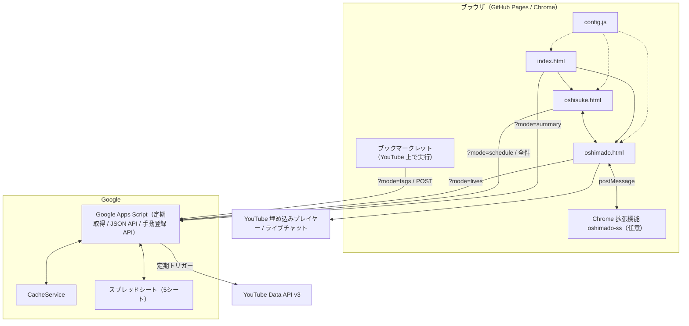

# 推しスケ！ & 推しマド！

**YouTube 配信スケジュール管理 Web アプリ（個人開発）**

推しの配信予定をひとまとめに確認できる「推しスケ！」と、複数の配信を並べて同時視聴できる「推しマド！」のセットです。サーバーは持たず、GitHub Pages と Google のサービス（Apps Script / スプレッドシート）だけで動くので、維持費はかかりません。

| ドキュメント | 内容 |
| :--- | :--- |
| **README.md**（このファイル） | 概要、全体構成、セットアップ手順 |
| [USER_GUIDE.md](./USER_GUIDE.md) | 画面操作・ショートカット・更新ルールのリファレンス |
| [統合仕様台帳.md](./統合仕様台帳.md) | 設定値・API・キャッシュ・連携プロトコルなどの確定仕様 |

---

## 1. できること

- **配信スケジュールの一元管理**：監視対象チャンネルの「配信中」「配信予定」「メンバー限定枠」を、開始時間順またはチャンネル別に一覧できます。
- **見落としがちな枠の補完**：他チャンネルでのゲスト出演枠やメン限枠を、ブックマークレットでワンクリック登録できます。
- **チャンネルディレクトリ**：気になったチャンネルをタグ付きでストックし、メイン／サブの2階層タグで絞り込めます。
- **最大6窓の同時視聴（推しマド！）**：5種類のレイアウト、ソロ音声の切り替え、並列／タブ切替のライブチャット、URL による窓構成の保存・共有に対応します。
- **Chrome 拡張機能（任意）**：各窓の原寸スクリーンショット保存、高評価用ミニウィンドウの再利用、埋め込み待機画面の表示補正を行います。

## 2. 画面構成

| 画面 | ファイル | 役割 |
| :--- | :--- | :--- |
| ポータル | `index.html` | 入口。配信中・予定件数のサマリーと各画面へのリンク |
| 推しスケ！ | `oshisuke.html` | 配信スケジュール／チャンネル一覧の閲覧・絞り込み・検索 |
| 推しマド！ | `oshimado.html` | 最大6窓の同時視聴プレイヤー |
| 共通設定 | `config.js` | GAS の URL、キャッシュキー、更新間隔などの一元管理 |

## 3. 全体構成

### 技術スタック

| レイヤー | 採用技術 | 役割 |
| :--- | :--- | :--- |
| フロントエンド | HTML / CSS / Vanilla JS（GitHub Pages） | 3画面。ビルド工程なし |
| バックエンド | Google Apps Script | YouTube Data API の定期取得、JSON API、手動登録の受付 |
| データベース | Google スプレッドシート（5シート） | 監視対象、配信キャッシュ、メン限手動枠、チャンネルディレクトリ、タグマスタ |
| キャッシュ | ブラウザ `localStorage` ／ GAS `CacheService` | 初期描画の高速化と API 負荷の軽減（3層構成） |
| 外部サービス | YouTube Data API v3 / IFrame Player API | 配信情報の取得、動画・チャットの埋め込み |
| 拡張機能 | Chrome 拡張機能（Manifest V3） | スクリーンショット、ミニウィンドウ制御、待機画面補正 |

### 設計の考え方

- **主（配信スケジュール）と副（チャンネルディレクトリ）を分離**：厳選した監視対象だけを常時追跡し、気軽にストックしたチャンネルがスケジュール画面のノイズや API クォータを圧迫しないようにしています。
- **API クォータの節約**：`search.list`（100ユニット）は使わず、チャンネル ID の `UC` を `UU` に置き換えたアップロード一覧に対して `playlistItems.list`（1ユニット）で最新枠を取得します。動画再生とチャット表示は公式の埋め込みを使うため、クォータを消費しません。
- **3層キャッシュ**：ブラウザ `localStorage` → GAS `CacheService` → スプレッドシートの順に参照し、待たせずに初期描画します。
- **自動取得と手動補完のハイブリッド**：定期バッチで集めつつ、監視外のゲスト枠やメン限枠、新規チャンネルは、ブックマークレットから数秒で追加できます。

## 4. 規模の目安

| 項目 | 現在 | 想定上限 |
| :--- | :--- | :--- |
| 配信監視チャンネル | 22ch | 最大 40ch |
| チャンネルディレクトリ | 220ch | 約 300ch（登録上限 500 件） |

この規模での処理時間・API クォータ・キャッシュサイズの見立ては、[統合仕様台帳.md](./統合仕様台帳.md) の「規模と性能の見立て・対策案」にまとめています。

## 5. 必要なもの

- Google アカウント（スプレッドシート、Apps Script、YouTube Data API の利用）
- GitHub アカウント（GitHub Pages での公開）
- Chrome（拡張機能を使う場合は **Chrome 102 以上**。Edge など他の Chromium 系ブラウザは未検証です）

## 6. セットアップ手順

### 6-1. スプレッドシートを準備する

新規スプレッドシートを作成し、次の2つのシートを用意します。残りの `メン限手動枠`・`チャンネルディレクトリ`・`タグマスタ` は、初回実行時に自動で作られます。

| シート名 | 内容 |
| :--- | :--- |
| `配信監視一覧` | 1行目はヘッダー。2行目以降に、A列＝チャンネル ID（`UC...`）、B列＝タグ（カンマ区切り）、C列＝フィルター表示名（任意） |
| `配信キャッシュ` | 空のシートを作成（ヘッダーとデータは初回同期時に自動で書き込まれます） |

### 6-2. Google Apps Script を設定する

1. スプレッドシートの「拡張機能」→「Apps Script」を開き、バックエンドコード（`コード.txt`）を貼り付けて保存します。
2. 左メニューの「サービス（＋）」から **YouTube Data API v3** を追加します。
3. 関数 `setupAdminToken` を実行し、実行ログに出力される**手動登録用の秘密トークン**を控えます（トークンは `ScriptProperties` のキー `ADMIN_SECRET_TOKEN` に保存されます。再発行したい場合は `rotateAdminToken` を実行します）。
4. 必要に応じて `initTagMasterSheet` を実行し、既存タグから `タグマスタ` シートを初期生成します。

### 6-3. Web アプリとしてデプロイする

1. 「デプロイ」→「新しいデプロイ」で、種類に **ウェブアプリ** を選びます。
   - 次のユーザーとして実行：**自分**
   - アクセスできるユーザー：**全員**（GitHub Pages とブックマークレットからのリクエストを受けるため）
2. 発行された URL（`https://script.google.com/macros/s/<DEPLOYMENT_ID>/exec`）を `config.js` の `GAS_URL` に設定します。
3. `config.js` と `index.html`・`oshisuke.html`・`oshimado.html` を、GitHub Pages の同じディレクトリに配置します。
4. 各 HTML には、`config.js` の読み込みに失敗したときのフォールバック値が入っています。`GAS_URL` を変えた場合は、その値も合わせて更新してください（詳細は[統合仕様台帳.md](./統合仕様台帳.md) の「運用ルール」）。

### 6-4. 定期実行トリガーを設定する

トリガーはコード内では作成しません。Apps Script の「トリガー（時計アイコン）」から、次の2つを手動で設定します。

| 関数 | 種類 | 間隔 | 役割 |
| :--- | :--- | :--- | :--- |
| `updateLiveCache` | 時間主導型・分ベース | 15分おき | 配信予定・ライブ状態の同期 |
| `updateChannelDirectory` | 時間主導型・日付ベース | 1日1回 | ディレクトリの登録者数・アイコン・最新投稿日の更新 |

### 6-5. ブックマークレットを登録する

1. `ブックマークレット.txt` の `GAS_URL` を 6-3 の URL に、`TOKEN` を 6-2 で控えた秘密トークンに書き換えます。
2. 書き換えた内容全体（`javascript:` から始まる1行）を、ブラウザのブックマークの URL 欄に貼り付けて登録します。

ブックマークレットは外部ファイル（`config.js`）を読み込めないため、`GAS_URL` を変えたときは手動で更新が必要です。使い方は [USER_GUIDE.md](./USER_GUIDE.md) を参照してください。

### 6-6. Chrome 拡張機能を導入する（任意）

推しマド！の📷（原寸スクリーンショット）と👍（ミニウィンドウ）を使う場合のみ必要です。ストア公開ではなく、ローカルに読み込む形式なので、費用はかかりません。

1. ローカルディスクに専用フォルダを作成します（仮想ドライブではなく、ローカルストレージ上を推奨します）。
2. `manifest.json`・`background.js`・`content.js` の3ファイルをフォルダに置きます。
3. 自分の GitHub Pages の URL に合わせて、次の**4か所**を書き換えます。

   | ファイル | 書き換える箇所 |
   | :--- | :--- |
   | `manifest.json` | `content_scripts` の2つ目の `matches`（`https://<USER>.github.io/<REPO>/oshimado.html*`） |
   | `background.js` | 定数 `OSHIMADO_ORIGIN` と `OSHIMADO_PAGE_PREFIX` |
   | `content.js` | 定数 `OSHIMADO_ORIGIN` |

4. Chrome で `chrome://extensions` を開き、右上の「デベロッパー モード」をオンにします。
5. 「パッケージ化されていない拡張機能を読み込む」から、作成したフォルダを選択します。
6. 推しマド！を開いているタブは、再読み込みしてください。

要求する権限は `storage` のみです。拡張機能は、推しマド！のページ、YouTube の埋め込みプレイヤー（`youtube.com/embed/*`・`youtube-nocookie.com/embed/*`）、視聴ページ（`youtube.com/watch*`）でのみ動作します。

### 6-7. 動作確認

- `index.html` を開き、配信中・予定件数と最終更新日時が表示されること
- `oshisuke.html` に配信スケジュールが表示されること（初回は、`updateLiveCache` を一度手動実行してからにしてください）
- 推しマド！で、📷・👍を押すと拡張機能が反応すること（導入した場合）

## 7. ファイル構成

| ファイル | 役割 |
| :--- | :--- |
| `index.html` | ポータル画面 |
| `oshisuke.html` | 推しスケ！ |
| `oshimado.html` | 推しマド！ |
| `config.js` | 共通設定（`window.OSHISUKE_CONFIG`） |
| `コード.txt` | Google Apps Script（バックエンド） |
| `ブックマークレット.txt` | 手動登録用ブックマークレット |
| `manifest.json` / `background.js` / `content.js` | Chrome 拡張機能 `oshimado-ss`（v1.3.3） |
| `README.md` / `USER_GUIDE.md` / `統合仕様台帳.md` | ドキュメント |

## 8. 注意事項

- **非公式のツールです**。YouTube および Google とは関係ありません。YouTube の利用規約と API の利用規約に従ってご利用ください。
- **Web アプリの URL を知っている人は、スケジュール表示用のデータを取得できます**。非公開にしたい情報はスプレッドシートに入れないでください。
- **秘密トークンは公開しないでください**。ブックマークレットに書き込んだトークンは、ブラウザの同期機能で他の端末にも渡ります。
- **YouTube 側の画面変更の影響を受けることがあります**。拡張機能の待機画面補正やミニウィンドウのチャット折りたたみは、YouTube の画面構造に依存しています。
- 個人開発のため、動作保証やサポートはありません。

## 9. ライセンス

リポジトリ直下の `LICENSE` ファイルを参照してください。
